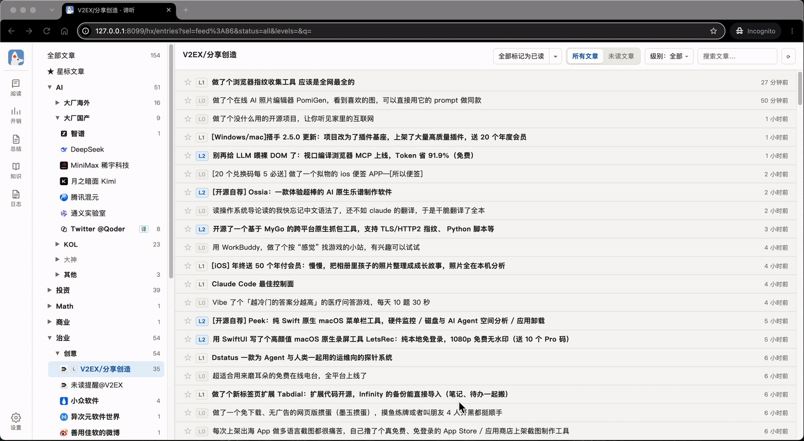
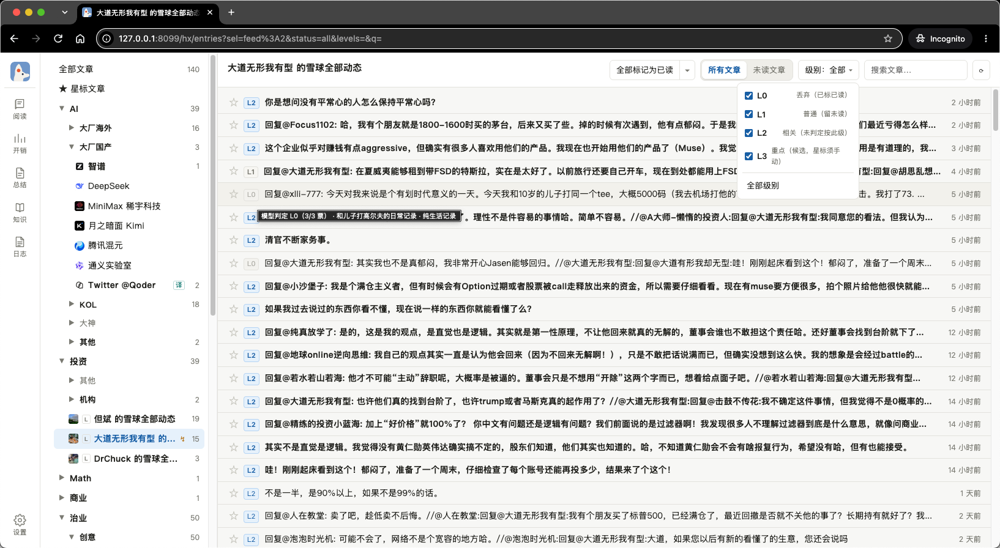
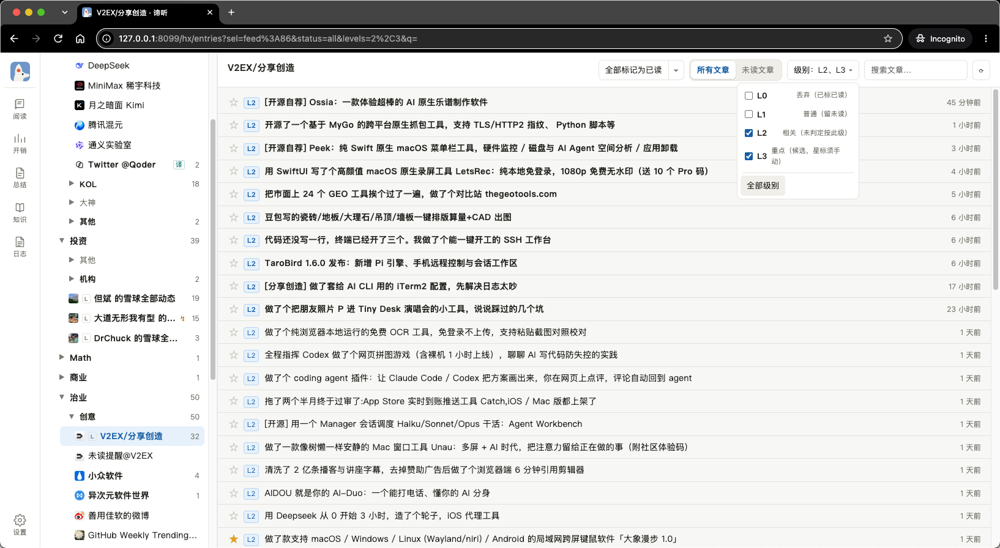
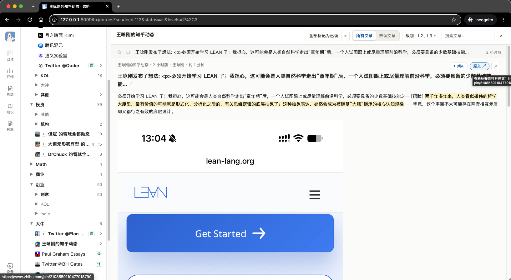
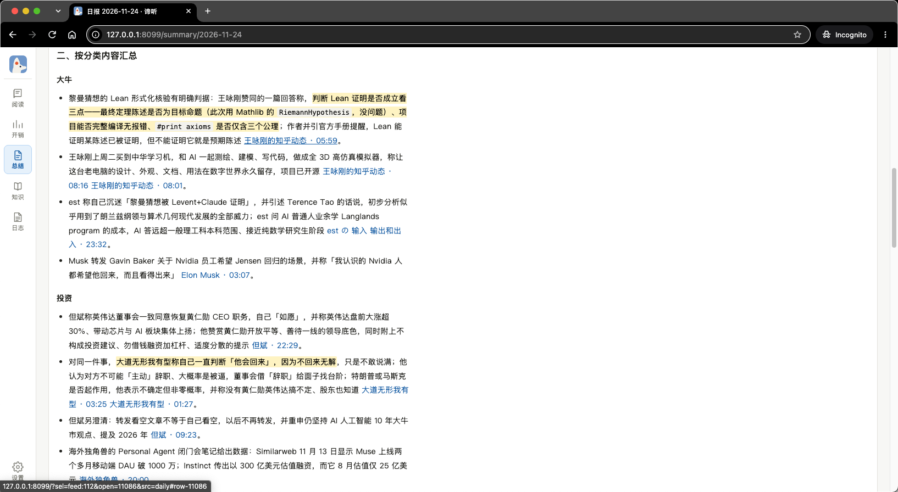
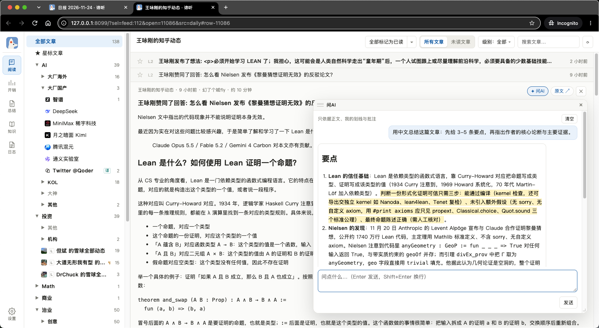
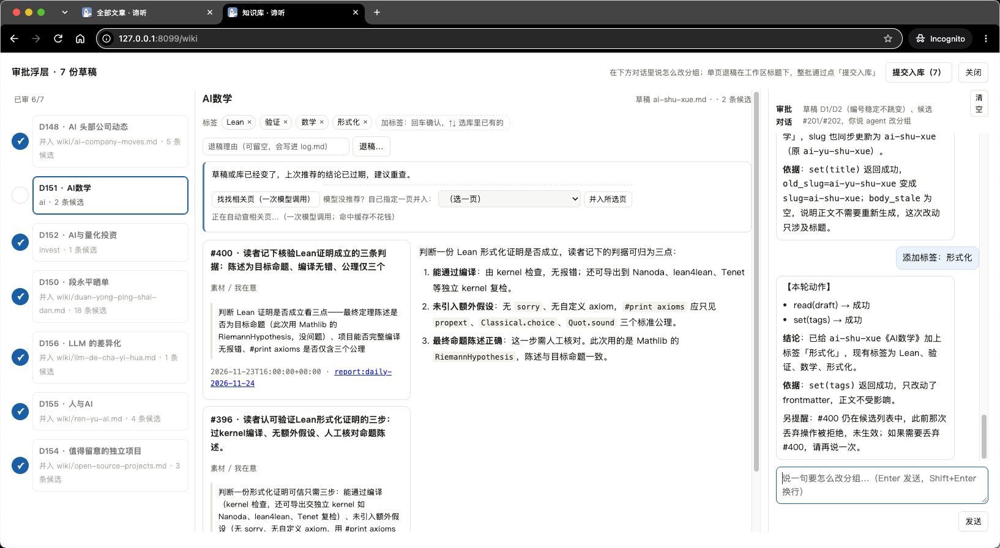
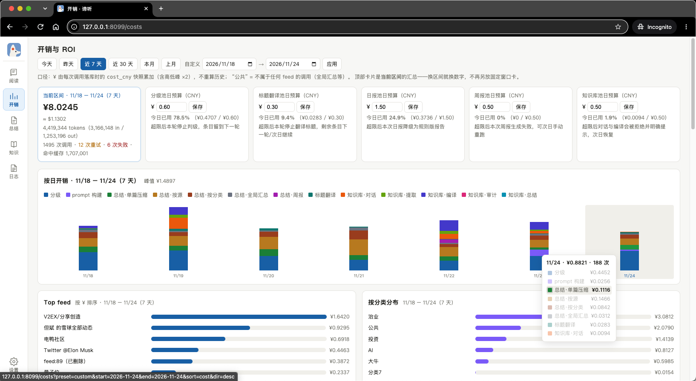

# 谛听RSS阅读器 · diting


[](LICENSE)


<p align="center">
  
</p>

> 伏地听万籁，明辨见真知

一个**抗 FOMO** 的个人信息分级系统。它不帮你读得更多，它帮你**决定不读**——
读到的少数值得留的，再沉淀成**你自己的知识库**。

给被订阅源/信息流淹没、想要「**少而准**」的个人读者。分级交给 LLM，但允许它按我的标准说
「这条不重要」。

存储全在本机；调用 LLM 时相关内容会发给你所选的服务商（详见
[常见问题](#常见问题)）。

---



---

## 它解决什么问题

信息焦虑的根源不是信息太少，是**筛选成本太高**。把 300 条内容压成 300 段摘要，
筛选成本没降，反而多了一层。

谛听的方向是反的：**在内容进入视野之前就分级，并且允许把大部分丢掉。**

| 级别               | 含义                       | 结果                     |
| ------------------ | -------------------------- | ------------------------ |
| **L0** 忽略        | 对读者没有信息价值         | 标记已读，不进日报       |
| **L1** 低价值/普通 | 保留价值有限               | 保留，不重点呈现         |
| **L2** 关注        | 与核心关切相关，值得读     | 正常展示                 |
| **L3** 重点        | 值得立刻看，常带可行动信息 | 优先呈现，可触发系统通知 |

你每天主要看 L2/L3，加一份日报。剩下的不是「读完了」，是「**不需要读**」。

而读过的东西里真正属于你的那部分——你的划线、你的批注、你问过的问题——
经你审批后沉淀成知识库页面。

---

## 快速开始

> **不想动手？整段交给你的 agent 就行**：下面的安装配置、起服务都是标准命令，
> 让 agent 照着敲；连「第一次打开」里的 feed 订阅、「配你的口味」里的分级判据，
> 也可以让它替你操作（它会用浏览器或调用 API）。你只需要亲自定两件事：
> **读者画像**（什么对你有价值）和**分级判据**（什么算重要）——那是你的判断，
> agent 可以起草，你拍板。

### 依赖

- Docker（跑 Miniflux + PostgreSQL + RSSHub）；macOS / Windows 桌面端装
  [Docker Desktop](https://www.docker.com/products/docker-desktop/) 即可（Linux 用原生 Docker）。
- Python 3.12+（开发环境为 3.13）
- 默认需要**一个 DeepSeek API key**（改用本地 Ollama 则不需要）——DeepSeek 是
  默认主力通道，去 <https://platform.deepseek.com> 创建；国内可直连，无需特殊网络。
  也支持其他 OpenAI 兼容服务（`.env` 里 `LLM_PROVIDER` 切换）。
- macOS 想要系统通知：`brew install terminal-notifier`
  （Windows 的 winotify 随 pip 自动装，见 [docs/notifications.md](docs/notifications.md)）

### 1. 起采集层

```bash
git clone https://github.com/fred2045/diting.git && cd diting
cp .env.example .env      # 必改：MINIFLUX_ADMIN_PASSWORD、POSTGRES_PASSWORD、DEEPSEEK_API_KEY（用本地 Ollama 则后者免）
docker compose up -d
```

采集层完全在后台运行，日常不需要碰它的任何界面；网页源拼 RSS 地址时用 RSSHub：
<http://localhost:1200>。

> ⚠️ **采集层默认只适合本机自用**：第一步要改的三个值里，`MINIFLUX_ADMIN_PASSWORD`
> 和 `POSTGRES_PASSWORD` 只是占位口令（`changeme` / `diting`），别原样留着。compose
> 把 Miniflux 的 `8080`、RSSHub 的 `1200` 绑到了所有网卡，配置里还开了「允许访问
> 私网」和「允许任意域名抓取」（RSSHub 在容器内网、要过 Playwright，本地自用必须开）。
> 对外暴露等于把弱口令后台 + 内网探测能力一起送出去：**别直接映射到公网**；确需
> 远程访问就走 SSH 隧道/反代鉴权，并先改掉上面两个口令。与下面 reader「没有登录
> 鉴权」是同一条原则。

### 2. 起阅读器

```bash
cd reader
python3 -m venv .venv && . .venv/bin/activate   # macOS/Linux
pip install -r requirements.txt
python manage.py migrate
python manage.py runserver 127.0.0.1:8099
```

Windows（PowerShell）：

```powershell
cd reader
python -m venv .venv
.venv\Scripts\Activate.ps1
pip install -r requirements.txt
python manage.py migrate
python manage.py runserver 127.0.0.1:8099
```

reader 和采集层读**同一份 `.env`**：启动时自动加载仓库根目录的它，采集层的凭据
就在里面——不需要单独配连接信息或 API token。

> ⚠️ reader **没有任何登录鉴权**，上面还是 Django 开发服务器——只监听
> 127.0.0.1 自用，**不要暴露到公网**。局域网/VPN 访问的注意事项见
> `.env.example` 开头与 [docs/deploy.md](docs/deploy.md)（对外前必须关 DEBUG、换 SECRET_KEY）。

### 3. 第一次打开

1. 打开 <http://127.0.0.1:8099>，在阅读页树上右键**新建分类、添加 feed**
   （网页源先去 RSSHub 拼好 feed 地址再加）；
2. 后台会自动抓取，**几分钟后列表里就出现内容**。此时徽标都是「未判定」——
   **分级只发生在配了判据的源上**，不配判据就当普通 RSS 阅读器用；
3. 想让模型替你筛，见下一步配口味。

### 4. 配你的口味

不需要改代码：

1. **读者画像** —— `cp Meta/interest-profile.example.md Meta/interest-profile.md`
   后改写成你自己：**你是谁、什么对你有价值**（只描述读者，不写级别判据；
   个人数据已 gitignore，不填也能跑）
2. 分类组织好（如 `10-投资`、`20-技术`）后，在分级配置页（树上右键 → 配置分级
   逻辑，`/triage/config`）给分类或单源写 L0–L3 的判据
3. 想用知识库：`cp Meta/ontology.example.md Meta/ontology.md`，在设置页 `/prefs`
   里定义你的**领域清单**（如 工作/技术/家庭——wiki 页面只会归档进这些领域）

全部阈值、开关、画像、本体都可以在设置页 `/prefs` 在线改。

---

## 核心能力

### 分级：帮你决定不读

分级默认**自适应投票**：出现 L2/L3 票即停，L1 两票定案（复核票只可能抬级、
不可能杀），全 L0 才补满 3 票且全票才判 L0；失败 fail-open 宁可多留。判据按
「画像 → 分类 → 单源」分层配置，prompt 版本落库可追溯。



树上 `L` 标记 = 该源配了分级判据；列表徽标区分「模型判过 / 失败兜底 / 未判定」，
悬停可看判定依据。



级别筛选是**多选组合**（`L1+L3`、只看 `L0`），阈值式的「L2 及以上」表达不了这些。



摘要不是替代：详情展开即读，「打开原文」有三个入口；每个要点都能点回原文。

机制细节（投票实测数据、四层配置边界、为什么不用规则）见
**[docs/triage.md](docs/triage.md)**。

### 日报 + 周报：带引用、数字核对过

日报每天 07:30 汇总上一个 24 小时窗口的 L1–L3，分层压缩成文；每个要点带
`[源名 · 时分](URL)` 可点回原文；模型改写或编造的数字会被机械核对并写进异常段；
失败、超限、引用不足都明写不粉饰。周报把 7 天日报合成一份（约 ¥0.13/周），
入口 `/summary`，失败可重跑。



### 知识库（wiki）：你的判断，沉淀成你的页面

读文章/日报/周报时**划线**（选中即存，可附备注）、**批注**、点页头「问AI」
浮窗带上下文对话——这些痕迹是唯一素材。`/wiki` 一键「编译成草稿」（提炼+编译
一条龙），在审批浮层里改标题标签、和 agent 讨论、并入已有页，**整批确认后**才
落盘为纯 Markdown（可直接指向 Obsidian vault）。





只接收你的高质量信号（划线/批注/原话），不从全文自动提取；候选引文必须逐字
对上你留下的痕迹。完整流程与锁机制见 **[docs/wiki.md](docs/wiki.md)**。

### 成本是可见的

每次 LLM 调用都记账：token、缓存命中、重试、耗时、人民币成本。五个预算池
独立计（分级 / 日报 / 翻译 / 周报 / 知识库），到顶即停、明确降级，并写进日报
异常段。模型供应商全部配置化，换模型不改代码。

更进一步，分级、标题翻译、wiki 草稿查相似这类**高频且对智力要求相对轻**的任务，
可按任务单独路由到免费模型 **agnes**（优先 + 主力模型兜底），失败自动回退、不会丢
结果——三处合计贡献了相当可观的成本节省，而判断质量经抽样对比不弱于主力通道。



### 顺带一提

- **标题翻译**：按 feed 开启中英对照，独立预算池，超限只停翻译 →
  [docs/translate.md](docs/translate.md)
- **系统通知**：L3 点名、日报/周报完成与失败直达页面（mac / win 都有后端）→
  [docs/notifications.md](docs/notifications.md)
- **虚拟分组**：在分类之下再组一层本地虚拟分组，分组关系只存本地，不改订阅本身

---

## 架构

```
RSS / API / RSSHub  ──▶  Miniflux（采集 · 正文 · 已读真相层）
                              │
                              ▼
                         谛听 reader（Django + SQLite：分级 · 日报/周报 · 翻译 · 痕迹 · 开销）
                              │
                              ▼
                           LLM（分级 · 压缩 · 对话 · 编译）
                              │
                              ▼
                         wiki/（纯 Markdown 落盘，可接 Obsidian / git）
```

**职责边界是刻意的：**

- **Miniflux** 是正文、已读、星标的**唯一真相层**。
- **RSSHub** 只负责「网页 → RSS」，不是必需品——原生 feed 可直接接。
- **谛听 reader** 只存「我们自己的数据」：分级结果、配置、prompt 版本、开销、
  日报状态、你的划线/批注/对话。
- **wiki** 是审批入库后的 Markdown 文件，归你所有，任何编辑器都能接管。

这条边界既是工程约束，也是合规约束：**谛听自己的库里没有正文副本**。

---

## 设计取舍

- **不做 L3 优先排序**：分级只决定「看不看」，不决定「先看哪个」——排序会引入新的 FOMO。
- **配置变动不重判历史**：历史判定保留当时的理由，可追溯比「一致」重要。
- **已读即归档**：把「标记已读」当过滤手段，而不是状态。
- **失败降级不丢数据**：解析失败 → L2，LLM 失败 → 默认级别，宁可多留。
- **知识库只收你的信号**：不从全文自动提取，入库必须人审批——宁可库小而真，不要大而水。
- **单进程**：Web + 调度同进程，SQLite WAL。个人规模不需要消息队列。

---

## 常见问题

**每天大概花多少钱？**
五个预算池默认日上限：分级 ¥0.6 + 日报 ¥1.5 + 标题翻译 ¥0.3 + 周报 ¥0.5 +
知识库 ¥0.5，**极端情况合计 ¥3.4 封顶**（`/costs` 或 `.env` 可调）。
按作者的真实运行校准：重度订阅（100 源、日均 160 多条新内容），
DeepSeek 价位下实测日均一块钱左右。**README 里的截图和金额只代表作者自己的用量**——
订阅少花得更少，订阅多也有上限兜底。超限不是静默失败：分级停调、日报降级为
规则版、知识库拒绝对话与编译，都会明说。调高预算前先看 `/costs` 的实际支出。

**支持哪些模型？**
任何 OpenAI 兼容的 `/chat/completions`（DeepSeek、其他兼容服务、本地 Ollama 均可）。
内置 DeepSeek 价目表用于估费（以官方现价为准），其他 provider 成本记为未知、
按每日调用次数兜底限流。

**我的数据存在哪？**
存储全在本机：Miniflux 持有正文/已读/星标（唯一真相层），谛听自己的 SQLite 只存
判定、配置、prompt 版本、开销、日报状态和你的划线/批注/对话——**不存正文副本**；
日报落盘 `data/reports/`，知识库落盘 `data/wiki/`（可改指 Obsidian vault）。
调 LLM 时，相关内容会随请求发送给你所选的模型服务商；要完全不出机器，用本地 Ollama。

**支持什么系统？**
macOS 主力开发测试；Windows 已支持（含系统通知，winotify 随依赖自动安装）；
Linux 理论可跑（Python + Docker + SQLite）但未验证。

**和「AI 摘要阅读器」的区别？**
分级决定**不读**，摘要只对留下的 L1–L3 做、且必带原文链接——摘要是索引，不是替代。
知识库也只沉淀你主动留下的痕迹，不自动生成「你没读过的知识」。

---

## 合规与使用边界

> 这一段是功能与风险说明，请认真读。

1. **个人自用工具，不是托管服务。** 作者不运营任何在线实例，不代任何用户抓取、存储或分发内容。
2. **不提供、也不附带任何规避网络访问限制的能力或配置。** 仓库内没有代理、镜像或离线一键包；所选 LLM 服务能否访问，取决于你自己的网络环境。
3. **订阅内容版权归各源站所有。** 分级是「判断」，不是「复制」；摘要有字数上限、强制带原文链接，定位是索引而非替代。
4. **登录态与凭据由使用者自行提供**，只存在本地 `.env`（已 gitignore）。请使用你自己的账号，并自行确认符合源站条款。
5. **使用者自行负责**：所订阅源的使用条款、所在地区法律、以及部署方式是否合规。**不建议将本项目部署为面向公众的内容服务**——那会改变你的法律身份。

---

## 文档

| 想了解             | 看                                                              |
| ------------------ | --------------------------------------------------------------- |
| 部署 / 运行 / 排错 | [docs/deploy.md](docs/deploy.md)                                |
| 分级机制细节       | [docs/triage.md](docs/triage.md)                                |
| 知识库完整流程     | [docs/wiki.md](docs/wiki.md)                                    |
| 标题翻译           | [docs/translate.md](docs/translate.md)                          |
| 系统通知           | [docs/notifications.md](docs/notifications.md)                  |
| 独立运维脚本       | [scripts/README.md](scripts/README.md)                          |
| 参与方式 / 报漏洞  | [CONTRIBUTING.md](CONTRIBUTING.md) · [SECURITY.md](SECURITY.md) |

## 致谢

Miniflux 与 RSSHub 以官方 Docker 镜像运行，本项目不分发其代码，各自遵循其开源
许可（见各自仓库）。

---

## 交流与支持

1. **GitHub Issues** 优先：bug、需求、用法疑问都欢迎。
2. 想深聊：加微信 **fred2025**，
   备注「**谛听**」或「**diting**」，拉你进谛听交流群。
3. 如果这个项目帮你省下了每天刷信息流的两小时：Star ⭐ 或赞赏都是支持。


---

## License

MIT（见 [LICENSE](LICENSE)）
